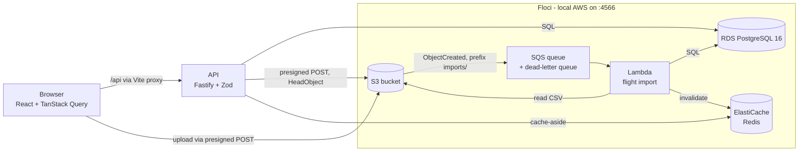

# Squawk

Squawk is a small maintenance and defect reporting system for an aircraft fleet. A _squawk_ is the aviation term for a defect report written by the crew.

The project is a reference implementation of a TypeScript stack on AWS: Node.js (Fastify), React, PostgreSQL on RDS, S3 uploads via presigned URLs, SQS, Lambda and ElastiCache, and later DynamoDB. Everything runs locally against [Floci](https://floci.io), a local AWS emulator. No AWS account is needed.

## Architecture



- The web app (`apps/web`) fetches data through a typed API layer that validates every response against the shared Zod schemas (`packages/shared`).
- The API (`apps/api`) serves JSON, validates input and output with the same schemas, and writes structured JSON logs with a correlation ID (`x-request-id`, taken from the request if valid, otherwise generated, and returned in the response).
- Defect attachments (JPEG, PNG, PDF, up to 10 MB) never pass through the API. The API returns a presigned POST whose policy fixes key, content type and exact size; the browser uploads to S3 directly and then confirms the upload, which the API verifies against the stored object.
- Flight logs are imported as CSV (`registration,flight_date,block_off,block_on,landings,cycles`, one row per flight, up to 5 MB). The upload triggers an S3 notification; SQS delivers it to a Lambda that validates every row and writes the flights. Rows are unique per aircraft and block-off time, so re-uploads and queue retries import nothing twice. Invalid rows are counted and listed by line number and reason, never by content; files that keep failing end up in the dead-letter queue ([ADR 0007](docs/adr/0007-flight-import-via-s3-sqs-lambda.md)).
- The due-date dashboard shows, per maintenance task, whether it is overdue, due soon or fine. Tasks have intervals in flight hours, cycles and/or days since the last completion; usage comes from the imported flights and is aggregated in PostgreSQL, the status from a pure rule in `packages/shared`. The result is cached in Redis under a versioned key, so a completed task or import is visible immediately and a slow reader cannot write stale data back; without Redis the API computes from the database ([ADR 0008](docs/adr/0008-redis-dashboard-cache-with-versioned-keys.md)).
- PostgreSQL runs as an RDS instance inside Floci. Floci starts a real Postgres container and exposes it through a proxy port on `127.0.0.1:7001`.

## Quickstart

Prerequisites: Docker, Node.js 24 or newer, pnpm (`corepack enable`). The [Floci CLI](https://github.com/floci-io/floci-cli) is optional and useful for diagnostics (`floci doctor`).

```sh
pnpm install
pnpm env:up   # starts Floci, creates the RDS instance, applies migrations and demo data
pnpm dev      # API on http://localhost:3000, web on http://localhost:5173
```

`pnpm env:up` creates `.env` from `.env.example` if it does not exist, and creates the attachments bucket, the ElastiCache cluster, the import queues and the importer Lambda (bundled from `apps/importer`). All AWS credentials in it are dummy values for Floci.

Stop everything with `pnpm env:down`. Floci keeps its state in memory, so the next `pnpm env:up` starts from a clean database.

## Tests and checks

```sh
pnpm test        # unit, component and integration tests (integration tests need pnpm env:up)
pnpm lint        # ESLint and Prettier
pnpm typecheck   # tsc in strict mode for every package
```

## API

| Method | Path                               | Description                                                                                                                                       |
| ------ | ---------------------------------- | ------------------------------------------------------------------------------------------------------------------------------------------------- |
| `GET`  | `/health`                          | `200` if the database is reachable, otherwise `503`. Not rate-limited.                                                                            |
| `GET`  | `/aircraft`                        | All aircraft, sorted by registration.                                                                                                             |
| `GET`  | `/defects`                         | Defects, newest first; optional `?aircraftId=`. Attachments carry a signed download link.                                                         |
| `POST` | `/defects`                         | Creates a defect. With an `attachment` declaration (name, type, size) the response includes a presigned POST.                                     |
| `POST` | `/defects/:id/attachment/complete` | Confirms the upload after verifying size and type of the stored object. Idempotent.                                                               |
| `POST` | `/imports`                         | Creates a flight import and returns a presigned POST for the CSV file (`text/csv`, exact declared size, up to 5 MB).                              |
| `GET`  | `/imports/:id`                     | Status (`pending`, `completed`, `failed`) with imported, skipped and rejected counts and the first rejected lines.                                |
| `GET`  | `/dashboard/due`                   | Maintenance tasks of the fleet with status (`overdue`, `due-soon`, `ok`) and remaining hours, cycles or days, most urgent first. Cached in Redis. |
| `POST` | `/maintenance-tasks/:id/complete`  | Sets the last completion of a task to now. Idempotent; invalidates the dashboard cache.                                                           |

All endpoints except `/health` are rate-limited (`RATE_LIMIT_MAX` requests per minute and client, default 100).

## Dashboard performance

`GET /dashboard/due` measured with autocannon (10 connections, 10 s) against 300 aircraft, 6000 maintenance tasks and 45000 flights on one developer machine, API and database both local in Floci:

| Variant                                              | Requests/s | p50 latency | p99 latency |
| ---------------------------------------------------- | ---------- | ----------- | ----------- |
| One usage query per task (N+1, kept as the baseline) | 2          | 4167 ms     | 4365 ms     |
| One aggregating query                                | 39.1       | 251 ms      | 357 ms      |
| One query plus Redis cache (warm)                    | 142.4      | 69 ms       | 97 ms       |

Only the ratios carry over to other machines. Reproduce with `pnpm load:seed`, `pnpm load:measure <label>` and `pnpm load:clean`. The baseline lives in its own commit (`d101e62`).

## Repository layout

```
apps/api/          Fastify API, SQL migrations, demo data
apps/web/          React app (Vite)
apps/importer/     CSV parsing and the import Lambda
packages/shared/   Zod schemas shared by API and web
scripts/           Local environment bootstrap
docs/adr/          Architecture decision records
docs/floci-notes.md
```

## Documentation

- [ADR 0001: Run Floci with Docker Compose](docs/adr/0001-run-floci-with-docker-compose.md)
- [ADR 0002: PostgreSQL through Floci RDS](docs/adr/0002-postgres-via-floci-rds.md)
- [ADR 0003: Run TypeScript natively on Node.js](docs/adr/0003-native-typescript-execution.md)
- [ADR 0004: SQL-first data access with node-pg-migrate](docs/adr/0004-sql-first-data-access.md)
- [ADR 0005: Presigned POST instead of upload through the API](docs/adr/0005-presigned-post-instead-of-upload-through-api.md)
- [ADR 0006: Explicit upload confirmation instead of S3 events](docs/adr/0006-explicit-upload-confirmation.md)
- [ADR 0007: Flight data import through S3, SQS and Lambda](docs/adr/0007-flight-import-via-s3-sqs-lambda.md)
- [ADR 0008: Dashboard cache in Redis with versioned keys](docs/adr/0008-redis-dashboard-cache-with-versioned-keys.md)
- [Floci notes](docs/floci-notes.md): verified emulator behaviour, gaps and workarounds

## Roadmap

| Status  | Milestone                                                                                 |
| ------- | ----------------------------------------------------------------------------------------- |
| Done    | Foundation: monorepo, local environment, API with health check, migrations, aircraft list |
| Done    | Defect reports with photo/PDF upload via S3 presigned URLs                                |
| Done    | Flight data import (CSV) via S3, SQS and Lambda, idempotency, dead-letter queue           |
| Done    | Due-date dashboard with Redis cache, invalidation and load measurement                    |
| Planned | Audit log in DynamoDB                                                                     |
| Planned | Terraform for all resources and a GitHub Actions pipeline                                 |
| Planned | Daily due-date notification via EventBridge Scheduler and SNS                             |
